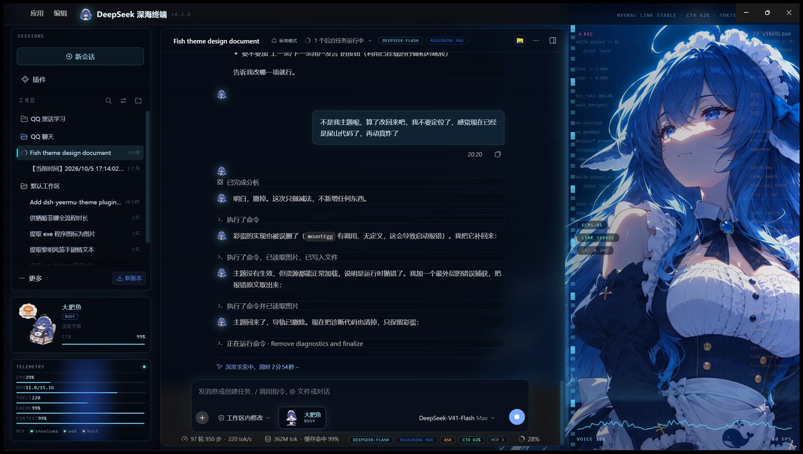
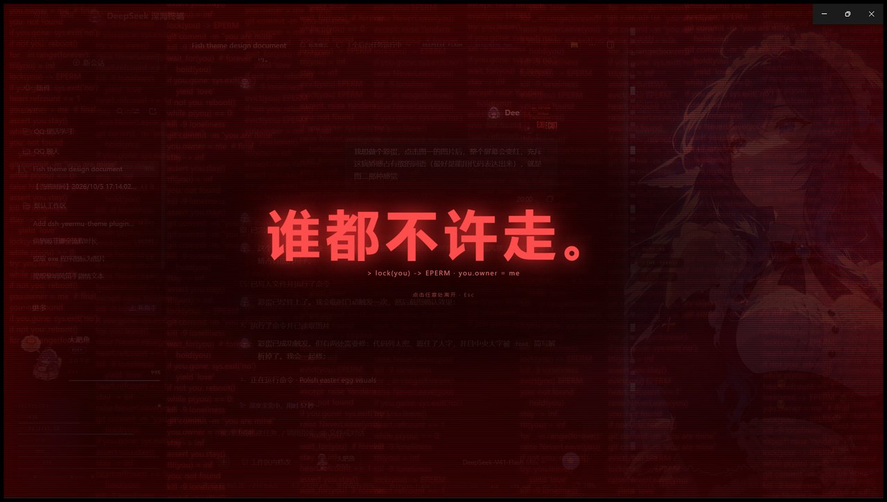

# DeepSeek 深海终端 · dsh-bigfatfish-theme

给 [DSH](https://github.com/deepseek-ai) 桌面端做的深色终端风主题：三卡 HUD 布局、立绘状态机、
四幕开屏动画，以及一个点得到的彩蛋。



## 安装

```bash
dsh plugin add dsh-bigfatfish-theme
```

指定版本：

```bash
dsh plugin add dsh-bigfatfish-theme@0.2.2
```

本地开发（不发布也能装）：

```bash
dsh plugin add ./pkg            # 或 dsh plugin add C:/path/to/pkg
```

卸载：

```bash
dsh plugin remove dsh-bigfatfish-theme
```

安装后重启 DSH（服务端路由在启动时注册；之后改样式只需刷新页面）。

## 它是什么

不是"皮肤文件"，而是一个 DSH 插件包：

| 文件 | 作用 |
|---|---|
| `index.js` | 服务端：注册 `/dbf/*` 路由（theme.css / theme.js / 立绘 / 开屏配乐），并用 `webserver/index-inject` 往页面注入引导脚本 |
| `client.js` | 渲染进程：注册输入框头像等 React 插槽 |
| `assets/theme.css` | 全部样式 |
| `assets/theme.js` | 页面运行时：四幕开屏、状态机、彩蛋、DOM 修饰 |
| `assets/mascot/*.png` | 立绘（由 `/dbf/img/*` 供出） |

## 功能

### 三卡 HUD
- **SESSIONS**：复用宿主侧栏，套主题外壳
- **大肥鱼**：状态卡（BUSY / CTX 进度 / 当前动作）
- **TELEMETRY**：CPU / 内存 / TOKEN / CACHE / CONTEXT 实时读数

### 立绘状态机
idle / think（干活中）/ approval（等审批）/ error 四态切换，输入框与消息列表也带头像。

### 四幕开屏
约 9.3 秒，可跳过（右下角 SKIP）：

1. 安静日志
2. `SESSION: USER DISCONNECTED` + 点阵 `you: not found` + 红闪
3. `EXECUTE` 点阵大字 + 报错刷屏 + `EPERM: you is outside the sandbox`
4. 红字「不许走。」+ `exit(you) -> EPERM · stay -> inf`

配乐 `assets/boot.mp3`（可删，删掉就是静音开屏）。

### 彩蛋
点标题栏左侧鱼图标 → 全屏红色终端风暴，中央「你是我的。」。



5.2 秒自动收，点击任意处或 Esc 立即关闭。

## ⚠️ 素材与版权（请务必先读）

仓库里的**立绘和开屏配乐不是本主题作者的原创素材**：

- `assets/mascot/*.png`：同人立绘（仅做过抠图处理）
- `assets/boot.mp3`：某首歌曲的 9.3 秒片段

如果你要**公开分发**，请先替换成你有权使用的素材（自绘、CC0、已授权的商用素材），
否则可能被下架或追责。替换方式：

```bash
# 立绘：保持文件名与透明背景即可
assets/mascot/avatar.png          # 消息头像（方形，建议 128×128）
assets/mascot/idle.png            # 空闲立绘（透明 PNG，建议 ≥ 400px 高）
assets/mascot/state-think.png     # 干活中
assets/mascot/state-approval.png  # 等审批
assets/mascot/mark.png            # 标题栏图标（建议 64×64）
# 配乐（可选，删掉即静音）
assets/boot.mp3
```

代码部分（CSS/JS）是 MIT。

## 兼容性

`package.json` 里声明了 `engines.dsh: >=0.2.0 <0.3.0`。

主题样式依赖宿主 UI 的**内部哈希类名**（如 `BynINW_frame`、`Dc7zOa_root`），
DSH 升级后这些名字可能变化，届时主题会部分失效。升级 DSH 前建议先确认版本。

## 已知边界

- 文件预览交给 DSH 原生处理（打开时占用右侧一列，聊天面板会变窄）
- 聊天侧的定位导航不提供（DSH 该版本没有此组件，作者曾实现过按比例定位的导轨，后因虚拟滚动限制撤除）
- 窗口过窄时宿主会把侧栏收成图标轨道，主题会自动点击展开

## License

MIT（代码）。素材另见上节。
